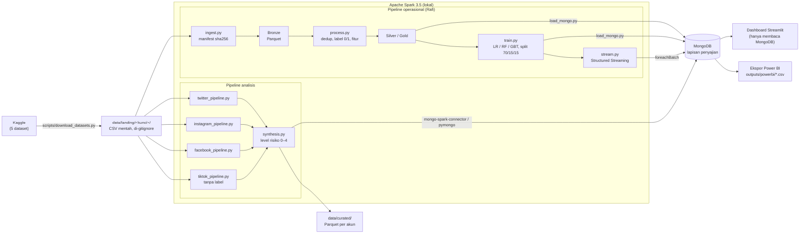

# Arsitektur

| Komponen | Kode | Keluaran | Di-commit? |
|---|---|---|---|
| Unduh data | `scripts/download_datasets.py` | `data/landing/<kunci>/` | tidak |
| Pipeline operasional | `src/ingest.py`, `process.py`, `train.py`, `stream.py`, `simulate_feed.py` | `data/{bronze,silver,gold}/<kunci>/`, `models/`, `reports/<kunci>/` | tidak (kecuali demo sintetis `twitter_bot_detection`) |
| Pipeline analisis | `src/*_pipeline.py`, `src/profile_tracks_utils.py`, `src/twitter_faker_check.py` | `outputs/metrics/`, `outputs/figures/`, `outputs/predictions/` | metrik & gambar tanpa identitas: ya; prediksi per akun: tidak |
| Sintesis | `src/synthesis.py` | `data/curated/`, MongoDB, `outputs/powerbi/` | tidak (berisi baris per akun) |
| Penyajian | `src/load_mongo.py`, `deploy/mongodb/docker-compose.yml` | koleksi MongoDB | — |
| Dashboard | `app/streamlit_app.py`, `scripts/seed_demo.py` | — | — |

Kedua jalur membaca file mentah yang **sama** di `data/landing/` dan menulis ke zona yang **berbeda**
(`data/{bronze,silver,gold}/<kunci>` vs `data/curated/` + `outputs/`), sehingga tidak saling menimpa.
Spark dipakai karena arsitektur menuntutnya (lihat [ADR 0003](adr/0003-spark-is-an-architecture-requirement.md)),
MongoDB adalah satu-satunya sumber data dashboard ([ADR 0004](adr/0004-streamlit-reads-mongodb.md)).
Koleksi dan tabel Power BI dijelaskan di [mongodb_powerbi.md](mongodb_powerbi.md).
