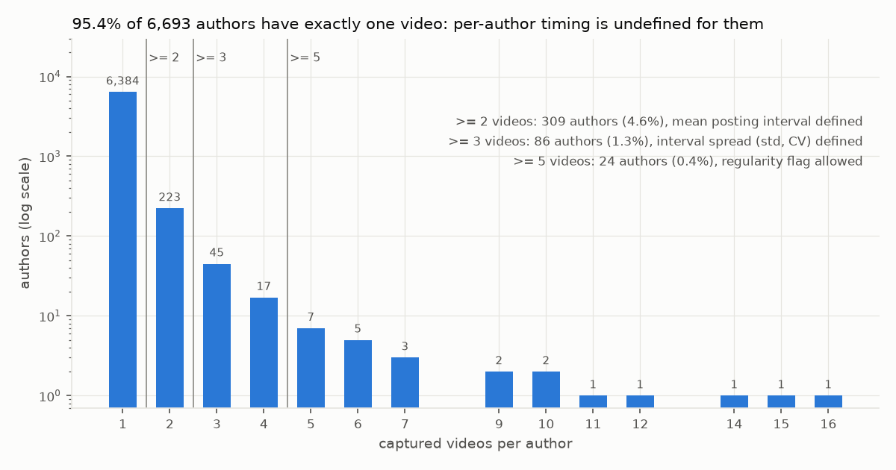
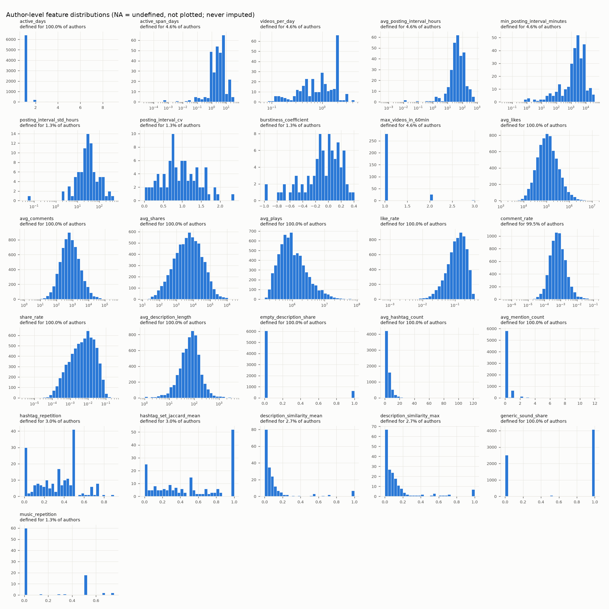
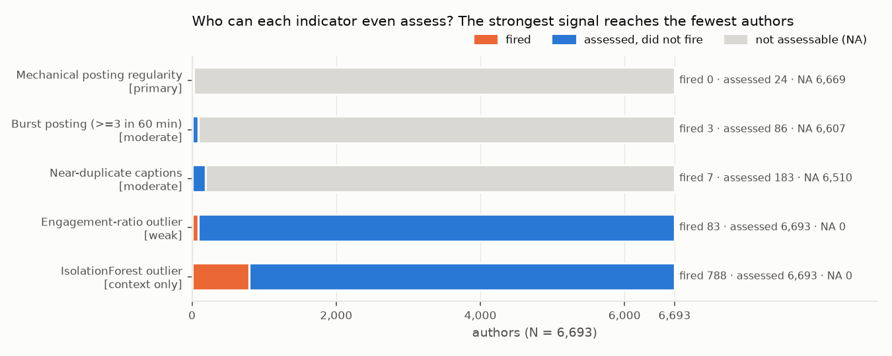
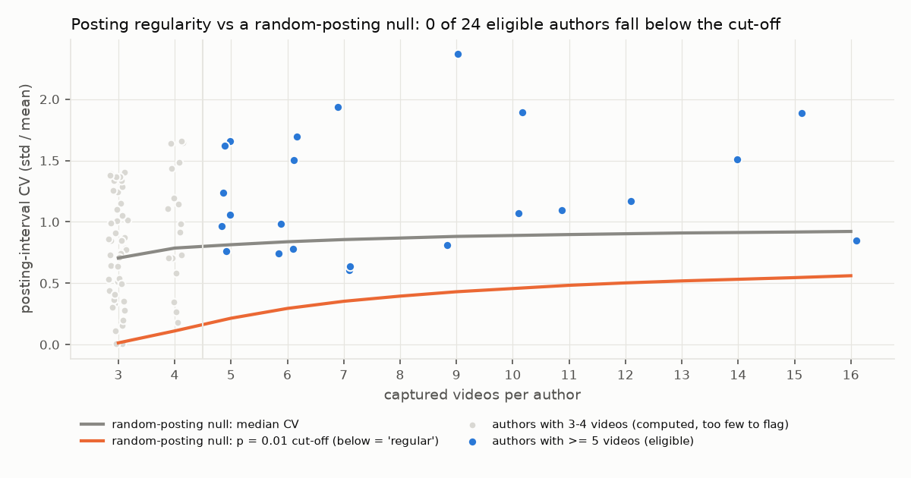
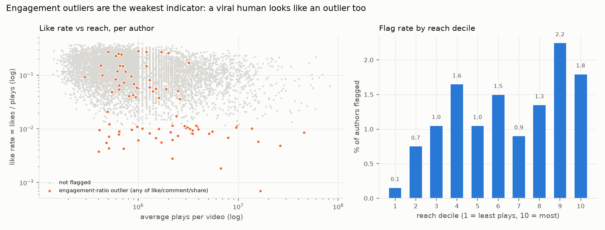
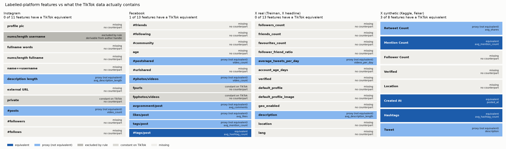

# TikTok track: findings

Group "Penyayang Claude", Teknologi Big Data, SV IPB University.
Pipeline: `src/tiktok_pipeline.py`. Metrics: [`outputs/metrics/tiktok.json`](../outputs/metrics/tiktok.json).
Author table: `outputs/predictions/tiktok_author_profile.csv` (generated locally, not committed: per-author output, docs/adr/0007). Figures: `outputs/figures/tiktok_*.png`.

> **This data has no ground truth, and none was created.**
> No TikTok account in this study is labelled a bot, and nothing here can say whether one is.
> No classifier was trained, so no accuracy, precision, recall or AUC exists for TikTok.
> Every flag in this track is an indicator that a human moderator *may* look at. It is
> never a verdict, never a label and never grounds for any automated action. Bot does not
> mean harmful, and an indicator firing does not mean bot. Accounts appear only under a
> pseudonymous key, and this document quotes no handle and no caption.

---

## Ringkasan (Bahasa Indonesia)

Data TikTok (7.225 video, 6.693 akun) **tidak memiliki label**, jadi jalur ini tidak melatih
model supervised dan tidak membuat label buatan. Pertanyaan data yang terbuka sudah dijawab.
`views` dan `plays` adalah kolom yang sama dari dua putaran scraping yang berbeda (tidak pernah
terisi bersamaan). Hal yang sama berlaku untuk `create_time` dan `posted_time`. `fetch_time`
99,9% kosong. **95,4% akun hanya punya satu video**, sehingga fitur waktu posting (interval,
keteraturan) tidak terdefinisi untuk sebagian besar data. Fitur tersebut dibiarkan NA, tidak diimputasi.
Sinyal otomasi terkuat (keteraturan posting yang mekanis) hanya bisa dinilai untuk 24 akun,
dan tidak ada satu pun yang lebih teratur daripada posting acak. Indikator yang menyala
(10 akun untuk tinjauan manusia, plus sinyal lemah) adalah **petunjuk untuk ditinjau manusia,
bukan label bot**. Transfer model dari Instagram/Facebook/X ke TikTok **tidak dapat dipertanggungjawabkan**.
Instagram 0 dari 11 fitur, Facebook 1 dari 13, dan X (data asli Treiman) 0 dari 13 fitur punya
padanan di TikTok. Data X sintetis memang punya 3 padanan, tetapi isinya buatan Faker. Diukur dari model
Random Forest masing-masing track, hanya 0–2,6% bobot fitur yang jatuh pada fitur yang ada padanannya di TikTok.
Followers, friends, umur akun, dan kelengkapan profil sama sekali tidak ada di data TikTok.
Tanpa label TikTok, skor hasil transfer juga tidak bisa divalidasi sama sekali.

---

## 1. Dataset and its real provenance

| | |
|---|---|
| Source | Kaggle `haziqhalifi/tiktok-2025-dataset`, file `tiktok_merged_data_deduplicated.csv` |
| Rows | 7,225 videos (`video_id` and `video_url` both unique, so the "deduplicated" claim holds) |
| Unit in file | video |
| Unit of analysis | author (6,693 distinct after normalisation) |
| Posting window | 2025-04-13 to 2025-05-24 |
| Label | **none** |

The file is a merge of **two scrape passes**. 7,218 rows come from one pass and 7 rows from
another. The second pass named the columns differently (`views`, `posted_time`), added a
`fetch_time`, and wrote author handles with a leading `@`.

**The sample is popularity-filtered.** Every video has at least 140,800 plays (median
895,700), and 86.8% of videos were posted in the last nine days before the scrape. So this is a
sample of *videos that were trending in May 2025*, not a sample of TikTok accounts.
Low-reach accounts are absent by construction, and that is where most spam and bot-farm
activity would sit. Any rate in this document describes this trending-video population and
nothing wider.

## 2. The open data questions, resolved

The concept document left these questions open. Each answer below was computed in the
pipeline, not assumed (`data_questions` in the JSON).

| Question | Finding | Decision |
|---|---|---|
| Are `views` and `plays` duplicates? | **Mutually exclusive.** `plays` is filled on 7,218 rows and `views` on 7. No row has both and no row has neither. They are most plausibly one quantity (TikTok's public play counter) under two names from two scrape passes. Because they never co-occur, their numerical equality cannot be checked. | Coalesce into one `plays`, with provenance in `plays_source`. This is an assumption, and it touches 7 rows (0.1%). |
| Do `create_time` and `posted_time` mean the same moment? | **Same split:** `create_time` is on the 7,218 rows and `posted_time` on the 7 others, never both. | Coalesce into `posted_at`, with provenance in `time_source`. |
| `fetch_time`? | Present on the same 7 rows only, and it has a single value (one batch timestamp). | Cannot be used. **Video age at scrape time is unknown for 99.9% of rows**, so engagement counts are not normalised for how long a video was exposed. |
| Author identity across passes | 6,694 raw handles but 6,693 authors: one author appears as both `@handle` and `handle`. | Strip `@`, trim and lower-case before grouping. |
| How many videos per author? | **6,384 of 6,693 authors (95.4%) have exactly one video.** 309 have ≥2, 86 have ≥3, 24 have ≥5, and the maximum is 16. | Timing features are left **NA** below the number of videos they need (section 4). Nothing is imputed. |



The pipeline also found these data-quality facts:

- **Counts are display-rounded.** TikTok shows "44.8K" and "1.2M", and the scraper stored
  44,800 and 1,200,000. 100% of counts ≥10k are multiples of 100, and 100% ≥1M are multiples
  of 100k. A play count of 1.2M is only known to about ±4%. The engagement scatter shows this
  as vertical stripes of authors just above 1M plays. Consequences: ratios carry a few percent
  of noise, and equal counts on two videos are not evidence of duplication.
- **Hashtags.** The `hashtags` column is empty on 62 videos whose caption contains `#tags`,
  and the caption has no `#` on 21 videos whose column has tags. Neither source is complete,
  so the pipeline uses their union.
- **Music.** 62% of videos (4,479) use a bare placeholder title such as "original sound",
  which comes in 28 localisations plus "no sound". Each placeholder is a *different* audio
  clip, so music repetition is computed over named tracks only. Otherwise every author who uses
  original audio would look like a "repeater".
- **Zero comments.** 34 videos with more than 140k plays have 0 comments. The most plausible
  reading is that comments were switched off, so these videos count as *unknown* for the comment
  rate, not as zero.
- **Empty captions.** 692 videos (9.6%) have no caption. This is a real value (length 0), not a
  missing one.
- **Posts at second :00.** 200 videos (2.77%) were published exactly on the minute, against
  1.67% expected by chance. This is consistent with scheduled posting, which TikTok offers
  natively to every creator. It is reported here at population level only, because scheduling
  is a normal creator tool and is not used as an indicator.

## 3. What was dropped, and why

| Column | Reason |
|---|---|
| `video_id`, `video_url` | Identifiers (contract rule 1). The URL also embeds the handle. |
| `author` | The grouping key, and an identifier. **Never a predictor.** It is replaced in every output by a pseudonymous `author_key` (truncated salted SHA-256). This is pseudonymisation, not anonymisation: a moderator holding the raw file can re-link a key in order to review the account, which is the point of the queue. The key-to-handle map is written only to `data/curated/` and must not be shared. |
| `fetch_time` | 99.9% missing. |
| `views`, `posted_time` | Merged into `plays` and `posted_at`. |
| `description`, `hashtags`, `music` (raw text) | Used only through engineered lengths, counts and similarities. Raw text is never a feature. |

The Instagram dataset ships a "digit ratio of username" feature, and the same ratio *could*
be derived from TikTok handles. It was deliberately **not** derived, because this track's
brief forbids using the author handle as a predictor.

## 4. Author-level behavioural profile

Spark aggregates the video level to the author level. Window functions compute posting gaps
and rolling 60-minute counts, and a self-join within each author compares caption and
hashtag pairs. Each feature is computed only where it is mathematically defined:

| Feature group | Features | Defined for |
|---|---|---|
| Volume | `video_count`, `active_days` | all 6,693 authors |
| Timing | `avg_posting_interval_hours`, `min_posting_interval_minutes`, `videos_per_day`, `active_span_days`, `max_videos_in_60min` | **309 (4.6%)**: needs ≥2 videos |
| Timing spread | `posting_interval_std_hours`, `posting_interval_cv`, `burstiness_coefficient` | **86 (1.3%)**: needs ≥3 videos |
| Engagement | `avg_likes/comments/shares/plays`, `like_rate`, `comment_rate`, `share_rate` | all (comment rate: 6,661) |
| Content | `avg_description_length`, `empty_description_share`, `avg_hashtag_count`, `avg_mention_count`, `generic_sound_share` | all |
| Repetition | `hashtag_repetition`, `hashtag_set_jaccard_mean`, `description_similarity_mean/max`, `music_repetition` | 85 to 204 authors (needs ≥2 comparable videos) |

Formulas for every feature, plus full distributions (n, mean, std, percentiles), are in
`features.engineered` and `descriptive_statistics` in the JSON. A few medians give a feel
for this population. The median author has one video with about 903k plays, an 11.9% like rate,
a 0.06% comment rate and a 0.55% share rate, plus a 62-character caption with three hashtags. Among the 86 authors where
it is defined, the median posting-interval CV is 0.89, close to the value of 1 that random
posting produces.



**What "missing is not zero" means here.** A single-video author has no posting interval.
That value is not 0 hours and not "average": it does not exist. Imputing it would invent
timing behaviour for 95% of the data. Undefined features are therefore left NA, and the
indicators that depend on them are **tri-state** (1 = fired, 0 = assessed and did not fire,
NA = not assessable). NA never counts as "clear".

## 5. Unsupervised indicators: for human review, not labels

### 5.1 The indicators and how much weight each one carries

| Indicator | Weight | What it measures | Assessable | Fired |
|---|---|---|---|---|
| Mechanical posting regularity | **primary** | Posting gaps more even than random posting would produce (CV below the p<0.01 cut-off of a simulated random-posting null) | 24 authors (≥5 videos) | **0** |
| Burst posting | moderate | ≥3 captured videos inside one 60-minute window | 86 (≥3 videos) | 3 |
| Near-duplicate captions | moderate | Two of the author's captions (≥3 words each, hashtags removed) with word-set Jaccard ≥0.8 | 183 | 7 |
| Engagement-ratio outlier | **weak** | Robust (median/MAD) z-score beyond ±3.5 on log like-, comment- or share-rate | 6,693 | 83 |
| IsolationForest outlier | **context only** | Multivariate isolation on engagement and caption features | 6,693 | 788 |



The figure above is the central result of this section. **The more an indicator can say
about automation, the fewer authors it can assess.** The one signal that points at
automation specifically (clockwork timing) reaches 0.4% of authors. The signals that reach
everyone are the ones most confounded with ordinary popularity.

### 5.2 Mechanical posting regularity (primary)

**Why it is the most defensible signal.** A scheduler or script posts at even intervals.
Humans post irregularly and usually in bursts. Of everything in this data, only timing
regularity points at automation rather than at popularity.

**How it is calibrated.** For each author the pipeline compares the coefficient of variation
of their posting gaps (CV = std/mean, where 0 is clockwork and about 1 is random) with
200,000 simulated authors who post completely at random (a Poisson process), each with the
same number of videos. An author is flagged only if their CV is lower than 99% of the random
ones (one-sided p<0.01). The simulation was checked against the exact analytic result for
3 videos, and the two match. Below 5 videos the test is not run: with 3 videos there are only
two gaps, and 14% of random posters would look "regular" at CV<0.2 purely by chance.

**Result: 0 of 24 eligible authors are more regular than random posting.** The most regular
eligible author has CV 0.60, against a cut-off of 0.22 at 5 videos that rises to 0.56 at 16.
The median eligible CV is 1.08, and 58% of eligible authors are *burstier* than random, which
is typical human behaviour. Lowering the bar to 3 videos flags 2 of 86 authors, against 0.86
expected by chance alone. Across the whole sensitivity grid (3 to 5 videos, p from 0.05 to
0.001), the flag count never clearly exceeds the number of false alarms random posting would
produce.



**What this does and does not show.** It does *not* show that there are no automated
accounts. Only viral videos were captured, so the gaps measured here are between an
author's *videos that went viral*, a thinned version of their real cadence. A perfectly
periodic poster whose videos go viral at random would show irregular gaps here. **A
non-flag is not evidence of human posting.** Benign causes of a flag (had one occurred) would
include TikTok's own scheduler, social-media managers, brand accounts and creators with a
fixed daily slot.

### 5.3 Burst posting and near-duplicate captions (moderate)

Burst posting fired for 3 authors and caption duplication for 7. No author fired both, so no
author reaches the priority tier. When the captions behind these flags were read during the
audit (locally, not reproduced here), they fit the benign explanations listed in the JSON:
- clip accounts posting several clips of one live-stream event within an hour;
- creators who reuse a fixed caption or sign-off on every video;
- a video re-posted days later with the same caption.

Each of these is worth a look by a moderator, and none is evidence of a bot.

The audit also found a **known blind spot**. One author posted three videos within 16 minutes
with an identical two-word caption. The 3-word minimum, which exists so that trivially short
captions do not count as "duplicates", hides that duplication, so this author sits in the
secondary tier rather than the priority tier. The threshold was set before the results were
seen and was **not** re-tuned to catch this case. Instead, the sensitivity grid below shows
what a different choice would do.

### 5.4 Engagement-ratio outliers (weak)

83 authors (1.2%) have an extreme like-, comment- or share-rate. This is the weakest
indicator, and the audit shows why:

- **It tracks reach.** The flag rate rises from 0.15% in the lowest-reach decile to 1.8 to
  2.2% in the top two deciles, roughly 12 to 15 times higher. Like rate falls as reach grows
  (Spearman −0.21), because viral videos reach casual viewers who do not like them. A low like
  rate on a very viral video is what popularity looks like.
- **It is partly a statistical artefact.** All 83 flagged authors have exactly one video
  (against 95.4% of all authors). Averaging over several videos pulls an author's rate
  towards the middle, so single-video authors are over-represented among extremes for reasons
  that have nothing to do with behaviour.
- **Direction is ambiguous.** Of the flags, 42 are low like rates, 16 low comment rates, 29
  high comment rates and 1 a low share rate. A high comment rate fits comment-bait,
  giveaways or a heated topic just as well as bought comments. No high like-rate outliers
  exist at all, because the like rate is capped near 0.40 in this population.

A high like rate is as likely to mean a loved human creator as bought likes. This indicator
should **never be the reason** an account enters a review queue.



### 5.5 IsolationForest (context only)

An IsolationForest (scikit-learn, 300 trees, `contamination='auto'`, seed 42) was run on
the features every author has: reach, like and share rate, caption length, hashtag count and
mention count. Spark MLlib has no isolation forest, and at this point the table has only
6,693 rows. It is included to show the group what a naive "just run anomaly detection" step
produces. It flags **788 authors (11.8%)**:

- The share flagged is set by the method's fixed score offset, **not** by how many bots exist.
- The flags are driven by @mention count (Spearman 0.44 with the score), then by low like
  rate and high reach. The forest flags 31.8% of the top reach decile, against 7.5 to 9.9% in
  deciles 1 to 8.
- It barely agrees with the engagement indicator: the two flag sets overlap by 43 authors,
  a Jaccard index of 0.05. **Two reasonable anomaly methods on the same data pick almost
  disjoint sets of authors.** That instability is itself evidence that neither is measuring a
  stable "inauthenticity" property.

### 5.6 Threshold sensitivity

No ground truth exists to calibrate any threshold, so each one is a judgement call. The
pipeline therefore reports how the counts move (`threshold_sensitivity` in the JSON). The
default is **bold**.

| Indicator | Range of settings | Authors flagged |
|---|---|---|
| Regularity | ≥3/4/5 videos × p 0.05/0.01/0.001 | 0 to 3 (**0**), never clearly above chance |
| Burst | ≥2/3/4 videos within 10 min / 60 min / 24 h | 0 to 117 (**3**) |
| Caption duplication | ≥1/2/3/5 words × Jaccard 0.6/0.8/1.0 | 5 to 15 (**7**) |
| Engagement outlier | robust z 3.0 / 3.5 / 4.0 / 5.0 | 161 / **83** / 36 / 10 |

The burst count can move by a factor of about 40 depending on the analyst's choice of window.
**These counts should not be read as prevalence estimates.**

### 5.7 Review tiers: a rule, not a score

Indicators are **not summed into a score**. Summing would let several weak,
popularity-driven signals outrank one strong one, and a "3 of 5 indicators" count would
suggest a precision the data cannot support. Each author gets one tier, by an explicit rule:

| Tier | Rule | Authors |
|---|---|---|
| `priority_review` | regularity fired, OR burst **and** duplication both fired | **0** |
| `secondary_context` | exactly one of burst / duplication fired | **10** |
| `weak_signal_only` | only engagement and/or IsolationForest fired. **Do not queue on this alone.** | 828 |
| `no_indicator_fired` | ≥1 behavioural indicator assessable and none fired. **This is not "authentic".** | 188 |
| `behaviour_not_assessable` | no behavioural indicator assessable and no weak signal | 5,667 |

For a trust & safety moderator, the honest review queue from this dataset is **10 accounts,
each with a stated reason and its benign explanations**. Every one of them may turn out to be
an ordinary creator. The precision of the queue is unknown, because nothing exists to measure
it against.

## 6. Coordination: cannot be claimed

The data contains no follower/following graph, no reply, duet or stitch links, and no device
or network signal. On TikTok, shared hashtags, sounds and captions are normal: trends are
built on them. The pipeline checked identical captions across authors. 29 distinct captions
are used by more than one author, and 23 of those consist only of hashtags. The most common
are `#fyp` (25 authors) and TikTok's own LIVE-programme partnership tags. **This shows trend
participation, not linked accounts.** No coordination claim is made, and none can be made
from this data.

## 7. Can a model trained on the labelled platforms be applied to TikTok?

**No. With these data, transferring a trained model is not defensible.** That is the
answer to concept-document section 5, and it is a finding in its own right.



| Labelled source | Source features | TikTok **equivalent** | Proxy, not equivalent | Constant on TikTok | Excluded by rule | Missing |
|---|---|---|---|---|---|---|
| Instagram | 11 | **0** | 2 | 1 | 1 | 7 |
| Facebook | 13 | **1** (hashtags/post) | 5 | 2 | 0 | 5 |
| X real (Treiman, the X headline dataset) | 13 | **0** | 2 | 0 | 0 | 11 |
| X synthetic (Kaggle, superseded) | 8 | 3 (mentions, hashtags, post time), but Faker-generated | 2 | 0 | 0 | 3 |

**What is missing entirely:** follower count, following/friends count, favourites given,
account age, profile picture, default-profile flags, display name, bio, external URL,
verified flag, location, language setting and groups. These are the profile and network
features that bot-detection models lean on. One trap is worth naming. X's `favourites_count`
is likes the account *gave*, while TikTok's `likes` are likes a video *received*. The two
share a word and point in opposite directions, so they must not be mapped onto each other.

**Checked against the sibling tracks' real models, not assumed.** The pipeline reads each
labelled track's Random Forest importances from `outputs/metrics/` and looks up every feature
in the mapping above. Engineered names such as `log1p_n_followers` and `lang=en` are traced
back to their raw column.

| Labelled model | Its top-5 RF features → TikTok status | Top-5 with a TikTok equivalent | Share of the forest's total importance on TikTok-equivalent features |
|---|---|---|---|
| Instagram | followers (missing), posts (proxy), username digit ratio (excluded by rule), bio length (proxy), profile picture (missing) | **0 of 5** | **0%** |
| Facebook | URLs shared (missing), communities (missing), friends (missing), share of posts with URLs (constant on TikTok), following (missing) | **0 of 5** | **2.6%** (hashtags per post, ranked 8th) |
| X real | followers (missing), favourites given (missing), friends (missing), tweets per day (proxy), verified (missing) | **0 of 5** | **0%** |

Put differently, **97 to 100% of what each labelled model learned rests on information the
TikTok data does not contain**, or contains only as a non-equivalent proxy. Numbers come from
`cross_platform.sibling_track_top_features`.

**Why the nominal matches do not rescue it:**

- *Scale.* Facebook `likes/post` has median 0.88 and TikTok `avg_likes` has median 106,800,
  five orders of magnitude apart. Facebook `avgcomment/post` has median 0.46 and TikTok has
  659. Instagram `#posts` (lifetime) has median 9, while TikTok's `video_count` is "viral
  videos captured in six weeks", median 1. These are not the same quantity.
- *Population.* The TikTok sample contains only viral videos. A model trained on ordinary
  accounts would be scoring a population it never saw.
- *The only X file with any equivalents is synthetic.* Its three "equivalent" features cannot
  carry real behaviour. The X/Twitter track established that the Kaggle file's tweet and
  hashtag vocabularies are exactly Faker's lorem word list
  ([`outputs/metrics/twitter_synthetic_faker_check.json`](../outputs/metrics/twitter_synthetic_faker_check.json)), and the file has exactly one tweet
  per user. The real X dataset that replaced it shares no equivalent feature with TikTok at all.
- *Labels do not match either.* The sources' labels mean spam, fake or bot respectively, which
  are different concepts (contract rule 7).

**A narrow transfer was considered and rejected.** Against a *real* labelled source, the
TikTok overlap is exactly one feature: hashtags per post, shared with Facebook. That feature
carries 2.6% of the Facebook forest's importance. Mentions per post can only be added from the
synthetic X file. One or two content-count features cannot carry a bot model, and on the
labelled data they are not where the signal sits. The sources also disagree with each other
on even these: Facebook "tags/post" has median 39, while synthetic-X mentions run 0 to 5. Rank-normalising within each platform would align the scales,
but only by assuming that a bot's percentile means the same thing everywhere. **Above all, TikTok has no labels.** A transferred score
could never be validated, its precision on TikTok would be unknown, and the lecturer's rule
that suspiciously high scores be audited could not even be applied. An unmeasured classifier
must not feed a moderation queue.

**What *does* transfer** is the method: author-level aggregation, explicit NA handling,
indicators instead of labels, and a human-review output.

**What would be needed to make TikTok supervisable:**
1. Account-level metadata per author: follower and following counts, total video count,
   account creation date, verified flag, bio and avatar.
2. A sample that is not popularity-filtered, including low-reach accounts.
3. A labelled TikTok subset built by documented human annotation (written criteria, two
   annotators, inter-annotator agreement reported), or an external ground truth such as
   platform takedown lists with stated provenance. **Never labels derived from this track's
   indicators.** That would be circular, and it is exactly the fabrication the concept
   document forbids.
4. A per-video scrape timestamp, so engagement can be normalised for exposure time.

## 8. Audit checks run

With no label there is no supervised leakage to test. The pipeline instead checked:

| Check | Outcome |
|---|---|
| Identifiers excluded from every feature and model input | Yes. `author` appears only as a pseudonymous key. |
| `video_id` / `video_url` unique | Yes (7,225 / 7,225). |
| URL consistent with the `author` and `video_id` columns | Yes, 0 mismatches. |
| Author namespace collision between scrape passes | 1 author found and merged. |
| Impossible values (likes > plays) | 0 rows. |
| Display rounding | Quantified (section 2). |
| Indicators confounded with reach | Engagement and IsolationForest flags both rise with reach (section 5). |
| Regularity test calibration | Simulation matches the analytic result at n=3. |
| Spark-side `sha2` key equals the documented Python `author_key()` | Asserted on every run. |
| Spark CSV parse row count = 7,225 | Asserted on every run. |

## 9. Limitations a reader must know

1. **No ground truth.** The precision of any flag is unknown, and so is the share of bots in this population.
2. **Popularity-filtered sample.** Every video has ≥140k plays, and low-reach accounts are absent.
3. **95.4% single-video authors.** The strongest signal is undefined for them.
4. **Thinned timing.** Intervals are between captured viral videos, not all uploads.
5. **No profile, network or account-age data.**
6. **Display-rounded counts** (about 3 significant figures).
7. **No exposure-time normalisation** (scrape time unknown for 99.9% of rows).
8. **Timezone undocumented.** Timestamps are treated as naive UTC, and hour-of-day is not interpreted.
9. **Coordination cannot be assessed.**
10. **Assumed equivalences.** views = plays and create_time = posted_time affect 7 rows and cannot be verified.
11. **Every threshold is a judgement call.** Section 5.6 shows how much each count depends on it.

False positives here would mean a real creator lands in a moderator's queue. That is why the
output is a short, reasoned review list with the benign explanations attached, and not a
sanction list.

## 10. Reproduce

```bash
# dari root repo; Java 17 di PATH atau JAVA_HOME di-set (lihat README)
python src/tiktok_pipeline.py
```

Spark runs in local mode through `common.get_spark` (2g driver, 3 cores) with session
timezone UTC. Seed 42 is used everywhere, and a run takes about 30 s. The run writes the JSON,
the CSV and six figures, plus local-only `data/curated/tiktok_videos_clean.parquet` and
`data/curated/tiktok_author_key_map.csv`. The key map contains handles, so do not share it.

**CSV columns** (`tiktok_author_profile.csv`, one row per author):
- `author_key`, then every feature in section 4;
- diagnostics: `regularity_p_value`, the robust z-scores, `iforest_anomaly_score`, and percentile ranks;
- the five tri-state `ind_*` flags (empty = NA = not assessable);
- `behavioural_indicators_assessable` and `review_tier`.
